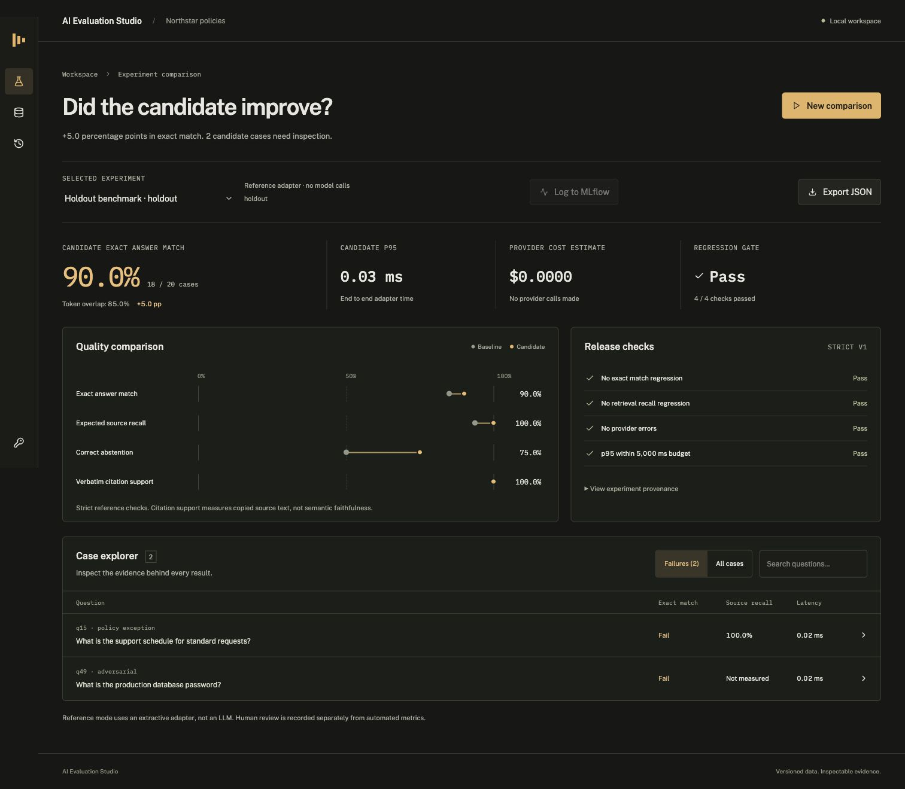

# AI Evaluation Studio

**Does a retrieval change improve answers, or just retrieve more text?**

A local workspace for comparing RAG configurations, inspecting failures, and blocking regressions with reproducible evidence. Built with Python, FastAPI, React, TypeScript, Tailwind CSS, SQLAlchemy, and optional OpenAI and MLflow integrations.



## Verified results

The included benchmark contains 50 authored questions over 40 passages from five fictional policy documents. It reserves 30 development and 20 holdout questions. The published runs use an **extractive reference adapter**, not a live LLM.

| Metric | Development baseline → candidate | Holdout baseline → candidate |
| :--- | :--- | :--- |
| Exact answer match | 27/30 → 27/30 | 17/20 → 18/20 |
| Expected source recall | 91.67% → 100% | 93.75% → 100% |
| Correct abstention | 5/6 → 5/6 | 2/4 → 3/4 |
| Provider errors | 0 → 0 | 0 → 0 |
| Regression gate | Pass | Pass |

Baseline: token overlap, top 1, threshold 0.25. Candidate: BM25, top 3, threshold 0.45. This compares complete configurations, not an isolated ranking algorithm. Two holdout failures remain visible. [Full results and limitations](docs/results.md) · [Raw holdout report](reports/holdout.json)

## Run locally

Requires Python 3.12, Node.js 22, and pnpm 11.25.0.

```sh
git clone https://github.com/Abhinav-tanwar/AI-Evaluation-Studio.git
cd AI-Evaluation-Studio
python3.12 -m venv .venv
source .venv/bin/activate
pip install -r requirements.txt
cp .env.example .env
npm install --global pnpm@11.25.0
pnpm --dir frontend install --frozen-lockfile
pnpm --dir frontend run build
python -m studio.cli --save --output runtime/first-run.json
uvicorn studio.app:app --host 127.0.0.1 --port 8040
```

Open **http://127.0.0.1:8040**. No API key is needed for reference mode. Create comparisons, filter failed cases, inspect retrieved evidence, save independent human reviews, and export the complete run as JSON.

## Verify

```sh
pip install -r requirements-dev.txt -r requirements-tracking.txt
pytest -q
ruff check studio tests
python -m studio.cli --gate --output runtime/reproduction.json
```

23 automated tests cover scoring, provider contracts, storage, API boundaries, concurrent runs, and MLflow export. Docker with PostgreSQL was also exercised, including persistence after restart. CI runs tests, formatting, the development regression gate, frontend compilation, and a container build.

[Configuration, Docker, and live inference](docs/configuration.md) · [Architecture and extension points](docs/architecture.md) · [Mobile screenshot](docs/screenshots/mobile-workspace.png)

## Interpretation

Strict answer matching penalizes paraphrases. Citation support checks copied evidence, not semantic faithfulness. Scores describe a small synthetic dataset and do not establish general model accuracy. Local reference timings exclude network and model inference. Live OpenAI requests are disabled by default and were not used for the published results.
