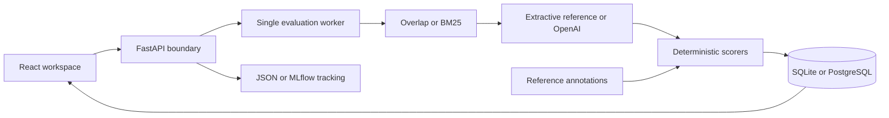

# Architecture

Reference annotations enter scoring only. The prediction adapter receives the question and retrieved passages, never expected answers. Corpus passages are versioned units of evidence with document and page labels; the app does not ingest arbitrary uploads.

The worker runs one comparison at a time, persists queued/running/completed/failed states, and marks interrupted runs failed on restart. This is a single process local tool, not a distributed task queue. Run one Uvicorn worker. Runtime history and annotations are deliberately excluded from Git.

The storage layer uses SQLAlchemy and JSON records in two tables. SQLite is the default. Docker Compose uses PostgreSQL with a persistent volume. MLflow export is optional experiment tracking: metrics, provenance tags, and the full evaluation artifact. It does not use an LLM judge or MLflow's GenAI evaluation engine.

The UI exposes automated scores separately from human annotations. Every exported case includes its answer, citations, retrieved evidence, reference, timing, usage, and sanitized error type. A failed gate exits the CLI with status 1.

## Extending the benchmark

Add source passages to `data/corpus.json` and annotated cases to `data/benchmark.json`. Increment the dataset version and reserve fresh holdout questions before tuning. Test annotation consistency with `pytest`. Dataset hashes change whenever either file changes. Existing reports retain their original fingerprint; compare only matching datasets.

Implement a new retriever in `studio/engine.py`, expose its configuration in `studio/schemas.py`, and add focused tests. A semantic scorer must use a distinct name and version. Do not relabel strict text matching as semantic correctness.
